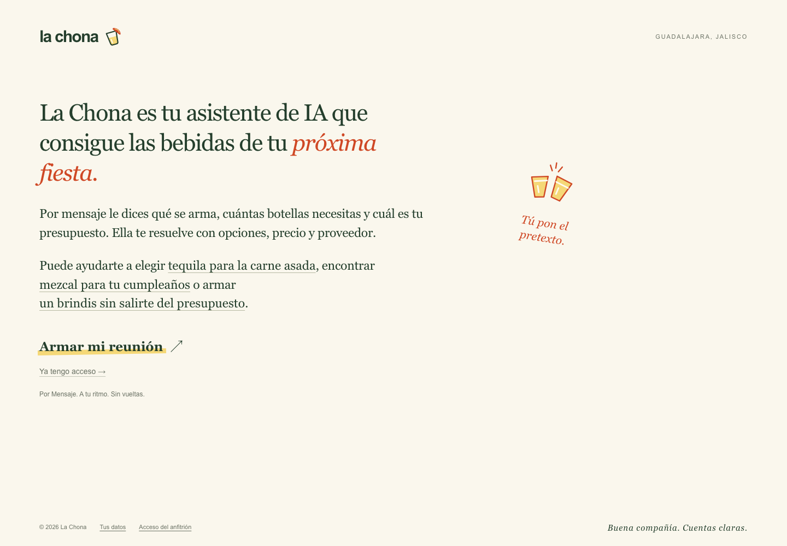
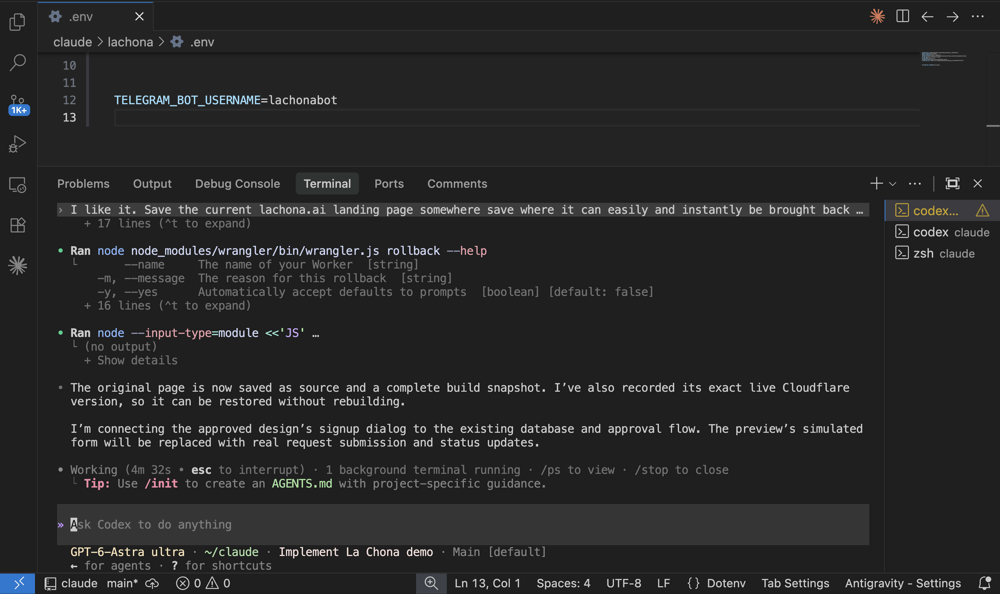

<h1>🎉 ¡Está viva! Conoce a La Chona 💃</h1>

<h2>Tu asistente de IA, diseñada para ayudarte a crear eventos, fiestas y reuniones inolvidables.</h2>

<strong>La Chona te ayuda a organizar tu evento, fiesta o reunión empezando por las bebidas, para que tú te ocupes de pasarla bien. ¡Próximamente, más funciones!</strong>

<h2><a href="https://lachona.ai">🥂 ¡Pide tu acceso exclusivo en lachona.ai! ↗</a></h2>

<strong>Acceso sujeto a aprobación.</strong>

<em>Nos vemos en la fiesta. 🎊</em>

[🌐 Solicitar acceso](https://lachona.ai) · [🎬 Ver presentación](https://www.loom.com/share/135a3098f5b14cd38d324bf965abad09) · [🛠️ Evidencia de Codex](docs/BUILT-WITH-CODEX.md)

---

## Tú pones el plan. La Chona encuentra las bebidas. 🍹

Organizar una fiesta suele empezar con pestañas abiertas, precios dispersos y mensajes a proveedores. **La Chona reúne opciones de bebidas con presentación, precio observado, proveedor y enlace a la fuente**, tomando en cuenta tu presupuesto y la cantidad que necesitas.

Por mensaje le dices qué se arma. Ella confirma lo que entendió y te devuelve opciones para decidir con cuentas claras.

> “6 botellas de tequila blanco, presupuesto $3,000, Zapopan, 30 invitados.”

**V1 ya funciona:** búsqueda de bebidas en un catálogo verificado de un proveedor de la zona de Guadalajara/Zapopan. Puedes pedir tequila, mezcal o whisky, ajustar la cantidad o bajar el presupuesto. Si no hay precio verificado —por ejemplo, para ciertas bebidas sin alcohol— lo dice: **cotización requerida**.

### ¿Cómo la pruebo?

1. Entra a **[lachona.ai](https://lachona.ai)** y toca **Armar mi reunión**.
2. Deja tu nombre y teléfono. La solicitud queda **pendiente de aprobación**.
3. Vuelve desde el mismo navegador: cuando se apruebe, aparecerá tu enlace a Telegram.
4. Cuéntale a La Chona qué necesitas, confirma el resumen y compara las opciones.

**[👉 Quiero mi acceso exclusivo](https://lachona.ai)**

## Lo que aprendimos: una fiesta se arma por etapas

Al principio queríamos crear un agente personal de IA que organizara **toda tu fiesta**: bebidas, comida, lugar, entretenimiento y coordinación. Al construirlo entendimos que necesitábamos avanzar por etapas.

**V1 se concentra en ayudarte a encontrar bebidas, destilados y opciones de proveedor que se ajusten a tu fiesta, reunión o evento.** Empezamos con un catálogo acotado para verificar precios, fuentes y cálculos antes de ampliar la cobertura.

**V2 viene en camino:** más proveedores, más servicios y más soluciones para organizar fiestas. Es nuestra siguiente etapa; esas funciones todavía no forman parte de V1.

Aprendizajes que ya se reflejan en el producto:

- Treinta invitados no significan treinta botellas: la cantidad se pregunta y se confirma.
- La IA interpreta el mensaje; el código valida los datos y calcula los subtotales.
- Un precio lleva fuente y fecha de observación. Existencia, entrega y envío se confirman con el proveedor.
- Una solicitud de acceso no equivale a una aprobación: el anfitrión decide antes de abrir el bot.

## Construida con Codex · Codex Build Day Guadalajara

**Proyecto:** La Chona · **Equipo:** Sergio el Bailador · **Integrante:** Sergio Duarte.

Codex colaboró en la implementación del bot, el flujo de acceso, la landing, las pruebas, el despliegue y las iteraciones del producto. La captura muestra una tarea concreta: conservar la landing anterior con una ruta de restauración y conectar la nueva landing al flujo real de aprobación.

**Cómo se verificó:** pruebas automatizadas de acceso, aislamiento, cantidades, cálculos y recuperación; compilación; revisión en escritorio y móvil; y un flujo real de solicitud → aprobación → enlace a Telegram. El benchmark local de cinco interpretaciones consecutivas tardó 60.44 segundos; **no es una medición de cinco usuarios reales simultáneos**.

Codex es la herramienta de desarrollo. La interpretación de mensajes del producto usa **Qwen local mediante Ollama**. La aplicación combina **TypeScript, Telegram, SQLite, React/Vinext y Cloudflare Workers + D1**.

| Para conocer o evaluar el proyecto | Enlace |
| --- | --- |
| Demo y solicitud de acceso | [lachona.ai](https://lachona.ai) |
| Presentación registrada | [Video en Loom](https://www.loom.com/share/135a3098f5b14cd38d324bf965abad09) |
| Guía breve para evaluación | [Evaluar La Chona](docs/EVALUATION.md) |
| Guion reproducible e instrucciones de ejecución | [Probar La Chona](docs/DEMO.md) |
| Trabajo con Codex y verificación | [Construida con Codex](docs/BUILT-WITH-CODEX.md) |
| Trabajo nuevo, componentes reutilizados y licencias | [Reutilización y atribuciones](docs/REUSE-AND-LICENSES.md) |
| Registro del proyecto | [Galería del evento](https://codex-guadalajara-jsconfmx-2026.aileenvl375305.chatgpt.site/projects#d0c9b12a-1711-4143-be9c-a56793f6959c) |

Este repositorio es la presentación pública del proyecto. La implementación y la documentación operativa se conservan en un repositorio privado. Para revisión técnica del código, [solicita acceso mediante un issue](https://github.com/sergiodeduarte/lachona/issues/new?title=Acceso%20para%20revisi%C3%B3n%20t%C3%A9cnica); el propietario debe concederlo. No publiques datos personales ni credenciales en el issue.

V1 compara opciones; no realiza compras ni garantiza stock o entregas. La disponibilidad del asistente depende del equipo que ejecuta la inferencia local. El alcance y las limitaciones forman parte de la demo.

---

## [💃 La próxima fiesta empieza aquí: pide tu acceso](https://lachona.ai)
